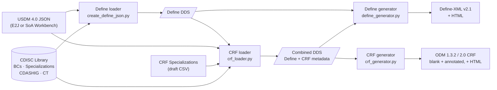

# Data Definition Engine


The **Data Definition Engine (DDE)** is an open-source tool that generates CDISC study artifacts — **Define-XML** and **ODM Case Report Forms (CRFs)** — from a machine-readable clinical trial protocol expressed in the **Unified Study Definitions Model (USDM)**. It is developed as part of the [CDISC 360i Program](https://github.com/cdisc-org/360i) by the Define-XML/CRF Generation Project Team.

**USDM** is a TransCelerate / CDISC standard that represents a clinical trial's complete protocol in a machine-readable JSON format: objectives, arms, visits, eligibility criteria, the schedule of activities, and the Biomedical Concepts each activity collects. It was co-developed through a formal partnership between CDISC and TransCelerate BioPharma as part of **TransCelerate's Digital Data Flow (DDF)** initiative, and it is the DDE's input — the "source of truth" for the study.

The DDE reads USDM 4.0 from both known producers, the **CDISC USDM Excel-to-JSON tool (E2J)** and the **[SoA Workbench](https://soa-workbench.cdisc.org)**. Both declare `usdmVersion` 4.0, so the loaders tell them apart by the shape of the data rather than by version.

---

## Table of Contents

- [Background](#background)
- [How It Works](#how-it-works)
- [Study Artifacts and Status](#study-artifacts-and-status)
- [Prerequisites](#prerequisites)
- [Installation](#installation)
- [Quick Start](#quick-start)
- [The Programs](#the-programs)
- [Project Structure](#project-structure)
- [Running the Tests](#running-the-tests)
- [Known Limitations](#known-limitations)
- [Key Concepts](#key-concepts)
- [Contributing](#contributing)
- [License](#license)
- [References](#references)

---

## Background

Clinical trials submitted to regulatory agencies (such as the FDA) must include standardized metadata files that describe the structure, content, and meaning of all datasets. Producing these files — most notably **Define-XML** — and the CRFs used to collect the data has traditionally been a manual, error-prone, and time-consuming process.

The CDISC 360i program aims to automate this process end to end: starting from a machine-readable study protocol (**USDM**), the DDE derives the metadata needed both to collect the data (CRFs) and to submit it (Define-XML). It closes the gap between protocol design and data submission by using the same source of truth throughout the study lifecycle.

---

## How It Works

The DDE is built as **loaders → DDS JSON → generators**. Loaders extract metadata from the protocol and the CDISC Library and write it into the **Data Definition Specification (DDS)**, a JSON model. Generators read the DDS and write study artifacts. The DDS file is the contract between the two halves.



- The **Define loader** reads the USDM, resolves each Biomedical Concept to its SDTM Dataset Specialization in the CDISC Library, and writes a Define DDS: datasets, variables, value-level metadata, codelists, and study-level metadata.
- The **CRF loader** is an *enrichment* loader — DDS in, DDS out. It reads the Define DDS and the USDM schedule of activities, picks a CRF Specialization for each Biomedical Concept, fills it out from CDASHIG and CDASH Controlled Terminology, and writes a **combined DDS** carrying both Define-XML and CRF metadata.
- Each **generator** reads the whole DDS file and ignores the sections it does not own: the Define generator skips forms, sections and study events; the CRF generator skips tabulation datasets, where clauses and methods.
- The CRF generator always embeds the SDTM mapping annotations, so **one ODM file is both the blank CRF and the annotated CRF (aCRF)**. Which one you see is a rendering choice.

> **Why a central JSON model?**
> No single source has all the metadata needed for a full submission. The DDS acts as an aggregation layer, combining protocol content, biomedical concept definitions, controlled terminology, and any manually filled gaps into one validated model.

See [`documents/Solution_Overview.md`](documents/Solution_Overview.md) for the full architecture and rationale.

---

## Study Artifacts and Status

| Artifact | Format | Produced by | Status |
|---|---|---|---|
| SDTM Define-XML v2.1 | `.xml`, `.html` | Define loader → Define generator | ✅ Implemented |
| ODM CRF v1.3.2 and v2.0 (blank CRF and aCRF in one file) | `.xml` | Define loader → CRF loader → CRF generator | ✅ Implemented, from draft CRF Specializations |
| CRF / aCRF HTML rendering | `.html` | `crf_generator.py --html` with [`stylesheets/`](stylesheets) | ✅ Implemented, based on Phase 1 stylesheets |
| ADaM Define-XML | `.xml` | — | 🔜 Planned |
| Trial Design datasets (TA, TD, TE, TI, TM, TS, TV) | Dataset-JSON | — | 🔜 Planned |
| Dataset-JSON shells | `.json` | — | 🔜 Planned |
| Lab Data Transfer Agreement → SDTM model | LinkML | [`src/dta2sdtm/`](src/dta2sdtm/README.md) | 📝 Draft model, no code |

Incremental loading with metadata provenance tracking, and quality and conformance checks on the DDS, are also planned.

> This project is provided "as is" without warranty or guarantee of suitability for any particular purpose. Expect breaking changes as the DDS model evolves and additional generators are developed.

---

## Prerequisites

- **Python 3.11+**. The loaders' `requirements.txt` files pin pandas 3.x, which requires it. pandas is used only for the optional Excel validation report (`--validation_report`) and for reading `.xlsx` CRF Specializations.
- A **CDISC Library API key**, required by both loaders. Request one at [CDISC Library](https://library.cdisc.org/).
- Git
- Optional, for HTML rendering:
  - `xsltproc` for Define-XML (XSLT 1.0)
  - [`saxonche`](https://pypi.org/project/saxonche/) for CRFs (XSLT 2.0): `pip install saxonche`

---

## Installation

```bash
git clone https://github.com/cdisc-org/data-definition-engine.git
cd data-definition-engine

python3 -m venv .venv
source .venv/bin/activate

# One environment for all four programs
pip install -r src/define-xml/requirements.txt \
            -r src/loaders/crf/requirements.txt \
            -r src/generators/define/requirements.txt \
            -r src/generators/crf/requirements.txt
```

Each program has its own `requirements.txt` if you only need one of them.

**Set your CDISC Library API key.** Create a `.env` file at the repository root; both loaders find it there:

```bash
# .env  (git-ignored)
CDISC_API_KEY=your_api_key_here
```

You can instead set `CDISC_API_KEY` in your environment, or pass `--cdisc_api_key` on the command line. Both loaders also accept `--base_api_url` to point at a CDISC Library proxy or caching mirror.

> **Windows:** activate with `.venv\Scripts\activate`, use a backtick `` ` `` instead of `\` for line continuation in PowerShell, and `\` as the path separator.

---

## Quick Start

This runs the whole pipeline on the study in the repository, [NCT01797120](data/protocols/NCT01797120), a SoA Workbench export. All output goes to the repository's git-ignored `output/` directory.

The Define programs must run from their own directory (see [The Programs](#the-programs)), so each step `cd`s from the repository root.

```bash
# 1. Define loader: USDM -> Define DDS
cd src/define-xml
python create_define_json.py \
  --usdm_file ../../data/protocols/NCT01797120/NCT01797120-latest.json \
  --output_template ../../output/NCT01797120-dds.json \
  --sdtmct 2026-03-27 \
  --patch_file ../../output/define-patch.yaml
cd ../..

# 2. CRF loader: Define DDS + USDM -> combined DDS
cd src/loaders/crf
python crf_loader.py \
  --dds_in ../../../output/NCT01797120-dds.json \
  --usdm_file ../../../data/protocols/NCT01797120/NCT01797120-latest.json \
  --dds_out ../../../output/NCT01797120-dds-crf.json \
  --crf_spec_file ../../../data/crf_specializations/cdisc_crf_specializations_draft.csv \
  --cdashct 2026-03-27 \
  --patch_file ../../../output/crf-refinement.yaml
cd ../../..

# 3. Define generator: Define DDS -> Define-XML v2.1
cd src/generators/define
python define_generator.py \
  -t ../../../output/NCT01797120-dds.json \
  -d ../../../output/define.xml
cd ../../..

# 4. CRF generator: combined DDS -> ODM CRF (2.0, then 1.3.2)
cd src/generators/crf
python crf_generator.py -t ../../../output/NCT01797120-dds-crf.json \
  -o ../../../output/crf-2.0.xml --odm-version 2.0 --validate
python crf_generator.py -t ../../../output/NCT01797120-dds-crf.json \
  -o ../../../output/crf-1.3.2.xml --odm-version 1.3.2 --validate
cd ../../..

# 5. Render HTML
xsltproc src/generators/define/define2-1.xsl output/define.xml > output/define.html
```

To render the CRFs, install `saxonche` and add `--html ../../../output --stylesheet ../../../stylesheets/odm_2-0_transform.xsl` to the 2.0 command in step 4 (or `odm_1-3-2_transform.xsl` for 1.3.2). It writes `crf-2.0_crf.html` (blank) and `crf-2.0_acrf.html` (annotated).

**What to expect.** Both ODM files pass odmlib and XSD validation, though some form text is still `__PLACEHOLDER__` and every visit collects no forms (see the CRF loader below). The Define-XML is a **draft**: values the loader cannot derive from USDM, such as variable `Length` and `Origin`, are written as `__PLACEHOLDER__`, so it will not pass schema validation yet. To finish it, fill in `output/define-patch.yaml` and re-run step 1 with `--apply_patch ../../output/define-patch.yaml` added, then step 3 with `-v`.

---

## The Programs

Each program has a README with the full argument reference. The Define loader and Define generator use flat top-level imports and **must be run from their own directory**. The CRF loader and CRF generator are regular Python packages: they also run as `python -m loaders.crf.crf_loader` and `python -m generators.crf.crf_generator` from `src/`.

### Define loader — `src/define-xml/create_define_json.py`

USDM → Define DDS. Calls the CDISC Library for Biomedical Concepts and SDTM Dataset Specializations. [Full reference](src/define-xml/README.md).

| Option | Purpose |
|---|---|
| `--usdm_file`, `--output_template` | Input USDM and output DDS paths (required) |
| `--sdtmct` | SDTM Controlled Terminology package date, `yyyy-mm-dd` (required) |
| `--sdtmig` | SDTMIG version (default `3.4`) |
| `--patch_file` / `--apply_patch` | Write a YAML file listing every value still `__PLACEHOLDER__`; fill it in and re-run with `--apply_patch` pointing at it. `--apply_patch` requires `--patch_file`, so the file is refreshed after each run. |
| `--validate` + `--validation_report` | Validate the DDS against the LinkML schema (`define.yaml`) and write an Excel report; the two are used together |
| `--debug` | Write intermediate `debug_*.json` files to the working directory |

### CRF loader — `src/loaders/crf/crf_loader.py`

Define DDS + USDM → combined DDS. Selects one CRF Specialization per Biomedical Concept and fills it out from CDASHIG and CDASH CT. [Full reference](src/loaders/crf/README.md).

| Option | Purpose |
|---|---|
| `--dds_in`, `--usdm_file`, `--dds_out` | Input Define DDS, input USDM, output combined DDS (required) |
| `--crf_spec_file` | The CRF Specializations `.csv`/`.xlsx`; see [its provenance](data/crf_specializations/PROVENANCE.md) |
| `--cdashct` / `--cdashig` | CDASH CT package date (required) and CDASHIG version (default `2.3`) |
| `--implementation_option` | `Denormalized` (default) or `Normalized`, for concepts with several CRF variants |
| `--patch_file` / `--apply_patch` | The refinement YAML: forms, sections, visit bindings, CRF variant choices, uncovered concepts |
| `--validate` | Validate against the CRF profile JSON Schema ([`schemas/dds/profiles/crf`](schemas/dds/profiles/crf/README.md)) |
| `--no_cache` | Bypass the on-disk CDISC Library cache (`.cache/cdisc_library`), which makes re-runs fast |

The refinement loop matters most for **visits**. SoA Workbench exports carry no activity-to-visit links, so every study event comes out with no forms. The refinement YAML lists candidate forms for each visit; bind them under `studyEvents` and re-run with `--apply_patch`.

### Define generator — `src/generators/define/define_generator.py`

DDS → Define-XML v2.1, using [odmlib](https://github.com/swhume/odmlib). [Full reference](src/generators/define/README.md).

| Option | Purpose |
|---|---|
| `-t`, `--template` | Input DDS JSON (required) |
| `-d`, `--define` | Output Define-XML path. **Always pass it**: the default is `tests/fixtures/define-360i.xml`, a committed test fixture. |
| `-v`, `--validate` | Schema-validate the output; exits `1` on failure |
| `-s`, `--submission` | Set `def:Context` to `Submission` (default `Other`) |
| `-x`, `--sas_xpt` | Use `.xpt` dataset extensions instead of `.ndjson` |

Render the result as HTML with `xsltproc` and the bundled [`define2-1.xsl`](src/generators/define/define2-1.xsl), or with `python -m defineutils.definehtml`.

### CRF generator — `src/generators/crf/crf_generator.py`

Combined DDS → ODM CRF, version 1.3.2 or 2.0 from the same input. Requires **odmlib ≥ 0.2.1**. [Full reference](src/generators/crf/README.md).

| Option | Purpose |
|---|---|
| `-t`, `--template` | Input combined DDS (required) |
| `-o`, `--odm` | Output ODM XML path (default `crf.xml`) |
| `--odm-version` | `1.3.2` or `2.0` (required) |
| `-v`, `--validate` | Validate with odmlib and against the ODM XSD |
| `--html` / `--stylesheet` | Also render the blank CRF and aCRF as HTML (needs `saxonche`) |
| `--forms` | Emit only these Form OIDs (comma-separated) |

---

## Project Structure

```
data-definition-engine/
├── data/                          # Inputs (see data/README.md)
│   ├── protocols/NCT01797120/     # USDM 4.0 study from SoA Workbench
│   ├── crf_specializations/       # Draft CDISC CRF Specializations (CSV) + PROVENANCE.md
│   └── metadata_xlsx/             # SDTM/ADaM metadata spreadsheets and the Define Excel template
├── documents/                     # Solution overview, glossary, presentations
├── schemas/                       # Vendored schemas (see schemas/README.md)
│   ├── dds/                       # DDS LinkML model, and profiles/crf (CRF profile)
│   ├── define/                    # Define-XML 2.0 and 2.1 XSDs
│   └── odm/                       # ODM 1.3.2 and 2.0 XSDs
├── stylesheets/                   # ODM 1.3.2 and 2.0 CRF stylesheets (XSLT 2.0)
├── output/                        # Generated files (git-ignored)
└── src/
    ├── define-xml/                # Define loader: USDM -> Define DDS
    ├── loaders/
    │   ├── common/                # Shared loader utilities (DDS I/O, USDM, Library cache, patching)
    │   └── crf/                   # CRF loader: Define DDS + USDM -> combined DDS
    ├── generators/
    │   ├── define/                # Define generator: DDS -> Define-XML v2.1 (+ define2-1.xsl)
    │   └── crf/                   # CRF generator: DDS -> ODM 1.3.2 / 2.0 (targets/ holds version differences)
    └── dta2sdtm/                  # Draft LinkML model for lab Data Transfer Agreements -> SDTM
```

---

## Running the Tests

None of the suites call the network. Run each from its own directory:

```bash
cd src/define-xml         && pytest tests
cd src/loaders/crf        && pytest
cd src/generators/define  && pytest
cd src/generators/crf     && pytest
```

---

## Known Limitations

- **Draft CRF Specializations.** The CDISC Library has no CRF Specialization endpoint yet, so the CRF loader reads a draft CSV copied from the Phase 1 POCs. It covers about half of NCT01797120's Biomedical Concepts (49 of 83); the rest are listed under `uncoveredConcepts` in the refinement YAML. See [PROVENANCE.md](data/crf_specializations/PROVENANCE.md).
- **Unbound visits.** SoA Workbench exports have no activity-to-visit links, so visits must be bound to forms by hand in the refinement YAML.
- **Define-XML from the combined DDS.** Currently, the DDS is populated using profiles and validating against a profile fails when the DDS combines Define-XML and CRF content. This is a known limitation and will be resolved in the near future.
- **Committed DDS file.** `data/protocols/NCT01797120/NCT01797120-dds-latest.json` was not produced by the Define loader and the Define generator cannot read it. The DDS generated by create_define_json.py works with the generator.

---

## Key Concepts

| Term | Definition |
|---|---|
| **USDM** (Unified Study Definitions Model) | A TransCelerate / CDISC standard that represents a complete clinical trial protocol as structured, machine-readable JSON. It is the primary input to the DDE. |
| **SoA Workbench** | A CDISC tool for authoring a study's schedule of activities that exports USDM JSON. |
| **CDISC 360i** | A CDISC initiative to make the full clinical trial lifecycle — from protocol to submission — machine-readable and interoperable. |
| **DDS** (Data Definition Specification) | The central intermediate JSON model in the DDE pipeline. It aggregates metadata from all sources and is the single input for all generators. |
| **Combined DDS** | A DDS carrying both Define-XML and CRF metadata, written by the CRF loader. Each generator reads the sections it owns. |
| **Define-XML** | An XML file submitted alongside clinical trial datasets that describes their structure, variables, permitted values, and controlled terminology. Required by the FDA. Define-XML v2.1 is an extension of ODM v1.3.2. |
| **ODM** (Operational Data Model) | The CDISC XML standard for exchanging clinical study metadata and data, including CRF definitions. The DDE generates CRFs in ODM v1.3.2 and v2.0. |
| **aCRF** (annotated CRF) | A CRF annotated with the SDTM variables each field maps to. The DDE emits one ODM file that renders as either the blank CRF or the aCRF. |
| **Biomedical Concepts (BCs)** | Standardized, reusable definitions of clinical observations (e.g., "Heart Rate") maintained in the CDISC Library. |
| **Dataset Specializations (DSSs)** | CDISC Library mappings that describe how a Biomedical Concept is represented in a specific SDTM domain. |
| **CRF Specializations** | Mappings that describe how a Biomedical Concept is collected on a CRF: its fields, prompts, codelists, and SDTM targets. |
| **CDASHIG / CDASH CT** | The CDISC standard for CRF data collection fields, and its controlled terminology. The CRF loader uses both to fill in CRF Specializations. |
| **CDISC Library** | CDISC's REST API providing access to controlled terminology, standards, Biomedical Concepts, and Dataset Specializations. |
| **odmlib** | A Python library for creating and parsing CDISC ODM and Define-XML documents, used by both generators. |
| **LinkML** | A modeling language used to define and validate the DDS JSON schema. |
| **VLM** (Value Level Metadata) | Metadata that applies to specific values within a variable (e.g., rules that only apply when `VSTESTCD = "SYSBP"`). |

More terms are defined in [`documents/glossary.md`](documents/glossary.md).

---

## Contributing

Contributions are welcome. Please read [CONTRIBUTING.md](CONTRIBUTING.md) before submitting pull requests. All contributions must follow the [Code of Conduct](CODE_OF_CONDUCT.md) and will fall under the project licenses below.

---

## License

### Code and Models
Licensed under the [MIT License](LICENSE).

### Content (documentation, etc.)
Licensed under [CC-BY-4.0](https://creativecommons.org/licenses/by/4.0/).

When re-using content, please cite as:
> Content based on [Data Definition Engine (GitHub)](https://github.com/cdisc-org/data-definition-engine) used under the [CC-BY-4.0](https://creativecommons.org/licenses/by/4.0/) license.

---

## References

- [CDISC 360i Program repository](https://github.com/cdisc-org/360i)
- [Data Definition Specification project](https://github.com/cdisc-org/DataExchange-DDS) — upstream of the DDS model in `schemas/dds/`
- [CDISC 360i Phase 1 CRF POCs](https://github.com/lexjansen/cdisc360i-pocs) — source of the draft CRF Specializations and the ODM stylesheets
- [odmlib](https://github.com/swhume/odmlib) — the Python ODM / Define-XML library both generators use
- [SoA Workbench](https://soa-workbench.cdisc.org) — producer of the USDM in `data/protocols/`
- [Phase 1 metadata gaps](https://wiki.cdisc.org/spaces/360i/pages/319525446/360i+Phase+1+Metadata+Gaps)
