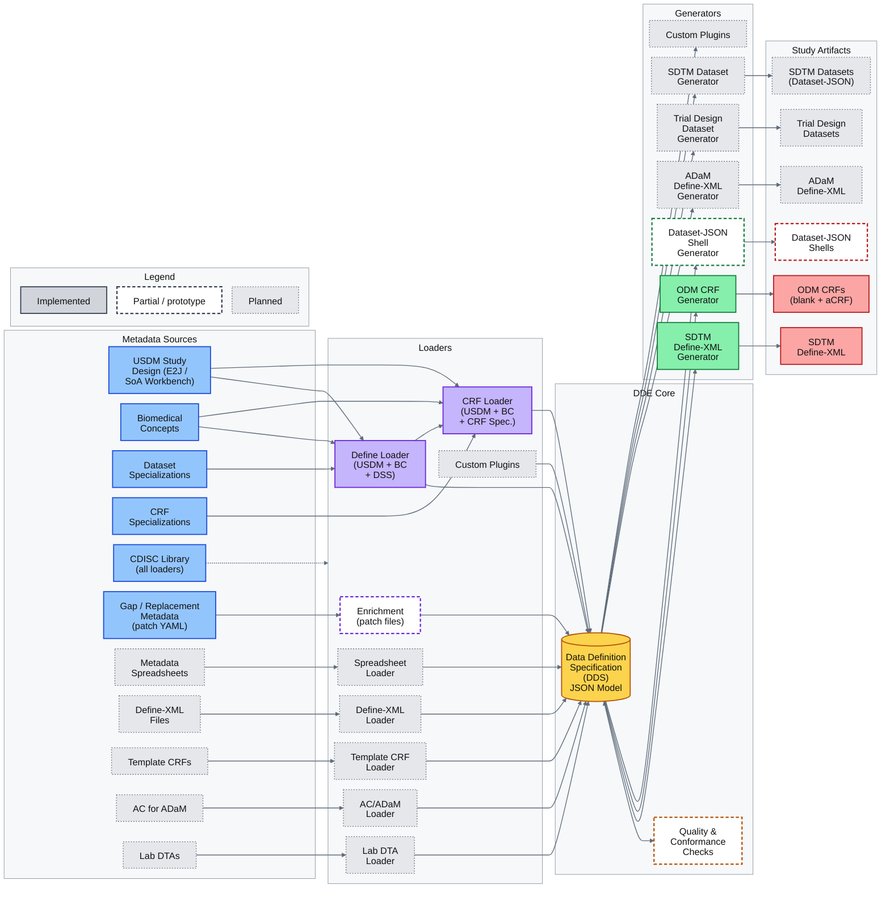

# Solution Overview

## Introduction
The Data Definition Engine (DDE) is a software tool being created by the Define-XML/CRF Generation sub-team of the 
CDISC 360i program. The DDE software populates the Data Definition Specification (DDS) model as JSON with the metadata 
needed to generate study artifacts, such as Define-XML, ODM CRFs, Dataset-JSON shells, and the Trial Design datasets. 

The DDE software includes multiple loaders and generators that use the DDS model. The loaders extract and load 
metadata content into the DDS model. The generators use the metadata in the DDS model to generate the study artifacts 
such as a define.xml or ODM-based CRFs. Two loaders and two generators are implemented today. Together they generate 
SDTM Define-XML and ODM CRFs from a USDM study design, accepting USDM 4.0 from both the CDISC USDM Excel-to-JSON tool 
(E2J) and SoA Workbench. The other loaders and generators are planned.

The following architecture diagram illustrates the overall flow from metadata sources through loaders into the DDS, 
and from the DDS through generators to produce study artifacts. Each component is marked as implemented, partially 
implemented or prototyped, or planned.

The primary 360i loader, the Define loader, reads the USDM study design content, gets the Biomedical Concepts 
referenced in the SoA, retrieves the Dataset Specializations (DSSs), and uses the CDISC Library API to populate the 
DDS model. The CRF loader then adds CRF metadata to the same DDS. A loader for the Excel metadata spreadsheets used by 
many organizations today remains a future option.

## Current Implementation
The implemented loaders and generators run as a pipeline. The Define loader writes a DDS; the CRF loader enriches 
that DDS with CRF metadata; and each generator reads the resulting **combined DDS**. The combined DDS is the contract 
between the two halves of the system: each generator reads the whole file and ignores the sections it does not own.

- **Define loader** (`src/define-xml/create_define_json.py`). Reads the USDM study design, resolves each Biomedical Concept in the schedule of activities to its SDTM Dataset Specialization, and builds the datasets, variables, value-level metadata, codelists, and study-level metadata. The specialization is taken from the USDM when the producing tool records it, and looked up in the CDISC Library otherwise. The two USDM producers seen so far both declare USDM 4.0, so the loader tells them apart by the shape of the data rather than by version.
- **CRF loader** (`src/loaders/crf/crf_loader.py`). An enrichment loader: it reads the Define DDS and the USDM, and writes a combined DDS that adds CRF content without changing the Define content. For each Biomedical Concept it selects one CRF Specialization by priority (an explicit USDM `crf` extension, then the SDTM Dataset Specialization, then the concept's code) and completes it from CDASHIG, with codelists from CDASH Controlled Terminology. USDM activities become forms and encounters become study events. CRF Specializations are read from a draft file, because the CDISC Library does not publish them yet.
- **Define generator** (`src/generators/define/define_generator.py`). Generates Define-XML v2.1 using odmlib.
- **CRF generator** (`src/generators/crf/crf_generator.py`). Generates ODM v1.3.2 or v2.0 from the same DDS. Every difference between the two ODM versions sits behind a single target abstraction, so the rest of the generator is written once. SDTM annotations are always embedded, so one ODM file is both the blank CRF and the annotated CRF (aCRF); which one you see is a rendering choice.

### Enrichment
No single source supplies every value a study artifact needs. Each loader marks the values it cannot derive as 
`__PLACEHOLDER__` and can write them to a YAML patch file. A person fills in the gap metadata, and can add replacement 
metadata for values the loader did derive. The loader applies the file on its next run, matching each value by OID, 
then refreshes the file with whatever is still missing. For CRFs the file also lists the candidate forms for each 
visit, and records for review the CRF variant chosen where a concept has several and the concepts that no CRF 
Specialization covers. This enrichment stage takes a study from an initial specification, through a refined 
specification, to a submission-ready artifact. A browser-based editor for patch files is being prototyped on the 
`patchUI` branch.

The CRF content in a combined DDS is itself a potential source for enriching the Define content. None of the 
following is implemented yet:
- **Gap and replacement metadata.** Some values the Define loader cannot derive are known from the CRF. For example, a variable collected on a CRF has a Collected origin.
- **Variables.** Each CRF item records the SDTM variables it maps to, and is linked only to those that exist in the datasets. A target variable with no link is collected on the CRF but missing from the dataset, and may be evaluated for inclusion.
- **Codelist subsets.** CRF codelists are often a different subset of the same NCI codelist that a dataset variable uses. A term collected on the CRF but missing from the dataset's subset may likewise be evaluated for inclusion.

Because a CRF can collect data that is not submitted, these are candidates for review, such as entries proposed in 
the patch file, rather than changes to apply automatically.

### Rendering
Define-XML is rendered as HTML with the Define-XML v2.1 stylesheet (`src/generators/define/define2-1.xsl`). ODM CRFs 
are rendered as a blank CRF or an aCRF with the XSLT 2.0 stylesheets in `stylesheets/`, which are based on the 
Phase 1 CRF proofs of concept.

### Schemas and Profiles
The `schemas/` directory holds copies of the DDS LinkML model and of the Define-XML and ODM XSDs, and the **CRF 
profile** of the DDS (`schemas/dds/profiles/crf/`), which is maintained here until it can move upstream. Profiles are 
described in [DDS Profiles](#dds-profiles).

See the [README](../README.md) for installation and a quick start, and each program's README for its options.

## Challenges
One of the most significant challenges to automating tasks like generating a define.xml or CRF file is aggregating 
all the metadata needed. This is a non-trivial challenge in most organizations. The DDS is designed to carry the 
complete set of metadata needed to generate these artifacts in addition to supporting other automation tasks. The 
DDS is the model at the center of the DDE solution. Loading the DDS will require a variety of metadata sources because:
1. There are gaps in the current metadata sources that necessitate pulling metadata from alternative sources to create a complete DDS
2. Different organizations maintain their metadata in different data storage systems and different formats, so the system must support a range of sources to be used by most organizations today
3. The DDS will source the metadata for many automation steps, requiring different metadata sources to satisfy different steps in the data pipeline.

The use of many new models in this process raises further challenges as they are unfamiliar to implementers and not yet 
mature. The DDS is drafted but not final. Using USDM + BCs + DSSs to generate study content represents the use of 
unfamiliar models in new workflows. Even more dramatic will be the use of the Analysis Concept (AC) models to generate 
the ADaM datasets.

Building the Define and CRF loaders surfaced two further challenges:
1. The same model version does not guarantee the same content. The two USDM producers seen so far both declare USDM 4.0, but they record Dataset Specializations in different places and fill different optional fields. Loaders must branch on the shape of the data rather than the version, and must not assume that a field is filled because it usually is.
2. Some of the standards content the DDE needs is not yet published. CRF Specializations exist only as a draft file that covers about half of a study's Biomedical Concepts (49 of 83 for NCT01797120), and CRF generation needed DDS model additions that are not yet part of the upstream model.

Once complete, the DDS provides the metadata for a wide range of study processing scenarios. Therefore, in addition to 
the need for an extensible set of metadata loaders, the DDE will require a set of generators to create different 
outputs and to drive automation.

## Loaders
Pulling metadata from multiple sources is necessary to load sufficient metadata into the DDS as well as to work with 
the metadata sources available at a sponsor company, such as in cases where the sponsor has not yet implemented the 
USDM model. A set of metadata loaders is part of the DDE solution. In 360i Phase 1 we created a loader that pulled 
metadata from the USDM + BCs + DSSs to support working directly from the digital study design. It has since been 
joined by a CRF loader that adds CRF metadata to the DDS. The loaders and their status:
- **USDM + BCs + DSSs**: *Implemented* as the Define loader.
- **USDM + BCs + CRF Specializations**: *Implemented* as the CRF loader, which adds to an existing DDS (see [Incremental Loading](#incremental-loading)).
- **CDISC Library**: *Implemented* as part of both loaders. The CRF loader caches Library responses on disk, so repeated runs are fast.
- **Phase 1 metadata gaps**: *Partial*. Addresses specific metadata elements identified during Phase 1 as unavailable from the primary sources (e.g., variable-level metadata not derivable from BCs or DSSs, missing computational methods, and other content required for complete artifact generation). Today these gaps are filled through the loaders' patch files (see [Enrichment](#enrichment)) rather than by a separate loader.
- **Lab Data Transfer Agreements (DTAs)**: *Planned*. A draft LinkML model of the lab DTA, tracing USDM and Biomedical Concepts through Dataset Specializations to SDTM, is in `src/dta2sdtm/`.
- **Template CRFs**: *Planned*.
- **Define-XML files**: *Planned*.
- **AC for ADaM**: *Planned*.
- **Metadata spreadsheet**: *Deprioritized*. A loader for the metadata spreadsheets commonly used in the industry remains a future option.

The DDE will support the implementation of plugins so that sponsors can build loaders to pull metadata from other 
sources, such as MDRs or other metadata spreadsheets. A loader plugin must conform to the DDE's plugin interface, which 
defines the expected inputs, the DDS structures the loader is responsible for populating, and how the loader registers 
with the DDE. This plugin contract will be documented to enable sponsors and third-party developers to extend the DDE 
to work with their metadata sources. No plugin interface exists yet. The nearest precursor is the CRF loader's CRF 
Specialization source, which reads from interchangeable sources (CSV or Excel today), so a CDISC Library source can 
replace the draft file without changing the rest of the loader.

## Generators
With a complete DDS prepared, the DDE provides a set of generators to create study outputs using the DDS metadata. 
The generators and their status:
- **SDTM Define-XML**: *Implemented* (`define_generator.py`), generating Define-XML v2.1.
- **ODM CRFs**: *Implemented* (`crf_generator.py`), generating ODM v1.3.2 and v2.0, with the blank CRF and aCRF in one file.
- **Dataset-JSON shells**: *Prototype* on the unmerged `dataset-json` branch, an XSLT transformation that generates Dataset-JSON v1.1 shells from a Define-XML file rather than from the DDS.
- **ADaM Define-XML**: *Planned*.
- **Trial Design datasets**: *Planned*.
- **SDTM datasets from Lab DTAs**: *Planned*.

As with the loaders, we plan to create a plugin capability for generators to enable implementers to add generators 
needed to support their use cases. A generator plugin must conform to the DDE's generator plugin interface, which 
defines how the plugin accesses DDS content and the expected output format. This will be documented alongside the 
loader plugin contract. No generator plugin interface exists yet. Internally, each generator maps every top-level DDS 
section to a handler class through a registry processed in a fixed order, and the CRF generator keeps the differences 
between ODM versions behind a target abstraction. These are conventions inside each generator rather than a contract, 
but they are a starting point for one.

## DDS Profiles
The DDS model is deliberately broad. It acts as a Rosetta Stone across CDISC ODM, USDM, Dataset-JSON, SDMX, FHIR, 
OMOP, and RDF, so it contains far more classes, slots, and optionality than any one loader or generator needs. A 
**DDS profile** carves a machine-readable slice out of the model for one use case, such as generating Define-XML or 
an aCRF. The [DDS Profiling Specification](https://github.com/cdisc-org/DataExchange-DDS/tree/main/profiles) defines 
how profiles are authored, resolved, validated, and published, following the pattern of HL7 FHIR profiles:
- **Differential.** A profile is authored as a LinkML schema that imports a pinned release of the DDS model and states only what it changes.
- **Tightening only.** A profile may make slots required, narrow ranges and value sets, prohibit slots, fix values, and enforce identifier patterns. It may never loosen the base model. The one sanctioned way to go beyond the model is a declared, namespaced **extension**.
- **Snapshot.** A resolver merges the differential onto the base model to produce a self-contained snapshot, from which a closed JSON Schema and other artifacts are generated.
- **Subset-plus-extensions conformance.** An instance that is valid against a profile is also valid against the base model once the profile's extensions are removed. A generic DDS consumer can therefore read any profiled instance by ignoring the extensions it does not understand.
- **Conformance claims.** An instance names the profiles it conforms to in the model's `profile` slot. Validation, not the claim, establishes conformance.

Profiles will play a central role in the DDE architecture:
- **Generator contracts.** Each generator implements against a profile rather than against the whole DDS: the Define-XML profile for the Define generator, the CRF profile for the CRF generator, and new profiles for the planned generators.
- **Loader contracts.** A loader's output is described by the profiles it populates. The profiles of the artifacts a study needs therefore determine which loaders must run to build its DDS (see [Orchestration](#orchestration)).
- **Readiness checks.** Whether a DDS is ready to generate an artifact becomes a question of whether it validates against that artifact's profile. The specification applies profile validation after placeholders are replaced, so a DDS with open placeholders is expected to fail, and validation follows [enrichment](#enrichment).
- **Combined DDS.** One DDS can carry the content of several profiles. The combined DDS claims conformance to both the Define-XML and the CRF profiles. Because each generated profile schema is closed, a combined DDS is validated against each profile after removing the other profile's extensions; there is no union profile.
- **Model evolution.** An extension that recurs across profiles signals content the base model should absorb, and is raised against DataExchange-DDS rather than left to diverge.

**Status: Partial.** The profiling specification is a draft in DataExchange-DDS, alongside a reference snapshot 
resolver and a draft Define-XML profile. The CRF profile is maintained in the DDE (`schemas/dds/profiles/crf/`). Its 
LinkML differential depends on CRF additions to the base model, such as questions and prompts on items, repeating 
item groups, and study events, that have been proposed upstream. Because a profile can only tighten the base model, 
the differential cannot be resolved until those additions land. Until then the CRF loader validates against a 
hand-written JSON Schema that tolerates the Define content in a combined DDS. The Define loader validates against an 
earlier copy of the full DDS model rather than the Define-XML profile, and validating a combined DDS against each 
profile in turn is not yet in place.

## Incremental Loading
To generate a complete Define-XML or CRF for use as a specification, there exists no single source of metadata. 
This means that metadata will be pulled from multiple sources. The metadata gaps identified during Phase 1 are 
examples of metadata content not available from our primary sources, where the primary source would be something like 
USDM + BCs + DSSs. To address the metadata gaps, the solution will need to pull the missing metadata from another 
source and add it to the DDS. 

This presents some workflow and technical challenges since we are updating existing DDS metadata but may not want to 
overwrite the existing metadata. Furthermore, we need the context of the gap metadata to accurately insert it into the 
DDS. To support that, there will need to be a mechanism to highlight which bits of metadata are part of the update and 
which are providing context. 

**Status: Partial.** The CRF loader is the first incremental loader. It reads a DDS written by the Define loader and 
adds CRF content to it (forms, CRF items and codelists, study events, and the CDASHIG standards) without changing the 
Define content. The whole input DDS serves as context; for example, each CRF item is linked to the SDTM variables it 
maps to. Patch files are the second mechanism: they enrich existing content in place, matched by OID. Loading 
content into a DDS that already holds content of the same kind is not yet supported: running the CRF loader on its own 
output adds the forms a second time.

### Orchestration
Incremental loading will almost certainly require an orchestrator of some kind, to make the initial and enrichment 
loaders work together to build the full DDS. Today the person running the pipeline is the orchestrator: they run the 
Define loader, pass its DDS to the CRF loader, and give each loader its own patch file. That works for two loaders, 
but the coordination grows with every loader added:
- **Order.** An enrichment loader depends on content that earlier loaders wrote. The CRF loader needs the Define DDS to link CRF items to SDTM variables, patch values apply only to OIDs that already exist, and enriching the Define content from the CRFs (see [Enrichment](#enrichment)) would add a step after both loaders.
- **Re-runs.** The CRF loader cannot yet be re-run on its own output, so when a source changes, the chain is re-run from the initial loader, applying each patch file at its step.
- **Ownership and conflicts.** Each loader owns some sections of the DDS and reads others as context. When two sources supply the same value, the orchestrator needs a rule for which wins, informed by the provenance described below.
- **Completeness.** The profiles of the artifacts to be generated determine which loaders must run, and validation against them shows when the DDS is complete (see [DDS Profiles](#dds-profiles)).

The orchestrator need not be a separate service; a pipeline definition that declares each loader's inputs, outputs, 
and profiles may be enough. It is also the natural place for loader plugins to register.

### Metadata Provenance
When loading metadata from multiple sources incrementally, the DDS should track the origin of each metadata element. 
Recording which loader and source populated a given piece of metadata supports auditability, simplifies debugging 
when generated outputs contain unexpected content, and provides the foundation for conflict resolution when multiple 
sources supply values for the same metadata element.

**Status: Partial.** CRF content records where it came from. Each CRF concept references its CRF Specialization and 
carries codings for its Biomedical Concept, SDTM Dataset Specialization, and CRF Specialization, the last with its 
package date. Forms and study events reference the USDM activities and encounters they were built from, and each CRF 
item links to the SDTM items it maps to. At the document level, the DDS records the standards and controlled 
terminology versions used. A per-element record of which loader populated which metadata is not yet in place.

## Incremental Generating
**Status: Planned.** Incremental generation could allow new content to be added to an existing artifact. For example, 
if there's a change that triggers the need to update a define.xml, but that define.xml has been updated manually or by 
another system, then the ability to add the new changes to the older define.xml has utility. This could work similar 
to GitHub, where a diff is generated and if possible, the updates are merged into the existing version.

## Quality and Conformance
Once a DDS is populated, checks determine the state of the DDS content to support generating specific outputs. Some 
of these checks exist today, at different stages of the pipeline; others are planned:
- **DDS validation**: *Implemented*. The Define loader validates its output against the DDS LinkML schema, and the CRF loader validates its CRF content against the CRF profile. Both can write an Excel report. Going forward, each DDS will be validated against the profile of every artifact it is meant to generate (see [DDS Profiles](#dds-profiles)).
- **Completeness checks**: *Partial*. Verify that the metadata required by a specific generator is present in the DDS before generation is attempted. For example, a check could highlight that the metadata necessary to generate the SDTM Trial Design datasets is missing or incomplete. Profiles make much of this check mechanical: a DDS that validates against a generator's profile has the content that generator requires. Today the patch files list every value that is still a placeholder, the CRF loader reports the concepts that no CRF Specialization covers, and the CRF generator warns about remaining placeholders and visits that collect no forms.
- **Cross-reference consistency**: *Partial*. Confirm that references between DDS elements are valid, such as ensuring that variables reference existing codelists and that dataset keys reference defined variables. Today odmlib checks the OID references in generated ODM, and the CRF loader links CRF items only to SDTM items that exist in the DDS. Checks across the whole DDS are planned.
- **Output validation**: *Implemented*. Test generated outputs, such as a define.xml or ODM CRF, against their standard schemas. Define-XML is validated against the Define-XML v2.1 schema, and ODM CRFs against the ODM schema and odmlib's model checks.
- **Conformance rules**: *Partial*. Apply specification-level conformance checks beyond schema validation, such as business rules defined in the Define-XML specification. Today only odmlib's ODM v1.3.2 conformance checks run; a rules engine is planned.

## References
- [DDE Repository](https://github.com/cdisc-org/data-definition-engine)
- [README](../README.md): installation, quick start, and links to each program's README
- [Data Definition Specification (DataExchange-DDS)](https://github.com/cdisc-org/DataExchange-DDS): the DDS model
- [CDISC 360i Phase 1 CRF POCs](https://github.com/lexjansen/cdisc360i-pocs): source of the draft CRF Specializations and the ODM CRF stylesheets
- [odmlib](https://github.com/swhume/odmlib): the Python ODM and Define-XML library both generators use
- [SoA Workbench](https://soa-workbench.cdisc.org): producer of the USDM used in development
- [Template2Define Repository](https://github.com/swhume/template2define): spreadsheet-to-Define tooling that a future spreadsheet loader may draw on
- [Automating Define-XML Generation in the CDISC 360i Program](presentations/2026-eu-interchange-define-xml-automation.md): 2026 EU Interchange presentation
